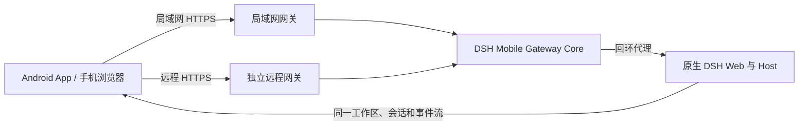

<p align="center">
  
</p>

<h1 align="center">DSH Mobile</h1>

<p align="center">在手机上安全、实时地使用电脑中的 DeepSeek Harness。</p>

<p align="center">
  <a href="https://www.npmjs.com/package/dsh-mobile"></a>
  <a href="https://www.npmjs.com/package/dsh-mobile"></a>
  <a href="https://github.com/saya-ch/dsh-mobile/actions/workflows/ci.yml"></a>
  <a href="https://github.com/saya-ch/dsh-mobile/releases"></a>
  <a href="#iphone-与-ipad主屏幕-web-apppwa"></a>
  <a href="LICENSE"></a>
  <a href="https://github.com/awesome-dsh-plugin/awesome-dsh-plugin"></a>
</p>

<p align="center">
  <a href="#下载-app">下载 App</a> ·
  <a href="#功能一览">功能一览</a> ·
  <a href="#快速开始">快速开始</a> ·
  <a href="#连接教程">连接教程</a> ·
  <a href="#安全">安全</a> ·
  <a href="#兼容性">兼容性</a> ·
  <a href="docs/README.md">文档</a> ·
  <a href="README.en.md">English</a>
</p>

> DSH Mobile 是 DeepSeek Harness 社区插件，原生 App 目前正式支持 Android；iPhone / iPad 可用 Safari 或[主屏幕 Web App（PWA）](#iphone-与-ipad主屏幕-web-apppwa)。
>
> **当前正式版本：插件 0.8.9 · Android App 0.7.5**，两者独立发布、版本号无需一致。[更新记录](CHANGELOG.md)

<p align="center">
  
  
  
</p>

## 下载 App

<p align="center">
  <a href="https://github.com/saya-ch/dsh-mobile/releases/download/android-v0.7.5/dsh-mobile-android-v0.7.5.apk"></a><br>
  <a href="https://github.com/saya-ch/dsh-mobile/releases/download/android-v0.7.5/dsh-mobile-android-v0.7.5.apk"><strong>下载 Android App 0.7.5（兼容版）</strong></a><br>
  <sub><a href="https://github.com/saya-ch/dsh-mobile/releases/download/android-v0.7.5/dsh-mobile-android-v0.7.5-iroh.apk">64 位完整版（含实验性 iroh）</a> · <a href="https://github.com/saya-ch/dsh-mobile/releases/tag/android-v0.7.5">版本说明与校验文件</a></sub>
</p>

🎬 <a href="https://github.com/saya-ch/dsh-mobile/releases">53 秒宣发视频</a>：扫码配对 → 同一会话 → 远程通道 → 任务通知 → 原理速览。

## 功能一览

### 扫码配对，一秒连回

电脑 **移动访问 → 局域网 → 生成配对二维码**，App 里扫一下即建立持久设备信任，同一 Origin 下自动续期。

<p align="center">
  
  
</p>

### 七种远程通道，出门也能连

Tailscale Funnel、cpolar、cloudflared（快速／命名隧道）、自建 FRP、自有反向代理、托管 Caddy，以及无需域名和公网端口的实验性 iroh。手机不需要装任何隧道客户端。

<p align="center">
  
</p>

各通道的取舍见[连接教程](#远程访问)；iroh 专属步骤见 [iroh 指南](docs/IROH.md)。

### 同一份会话，手机上全都有

手机连上后自动就是电脑的全部会话：同一工作区、消息、工具，实时同步，无需挑选或同步。

<p align="center">
  
</p>

### 任务跑完，第一时间提醒你

Android 任务完成与待输入提醒（原生通知通道，锁屏脱敏）；iPhone / iPad 主屏幕 Web App 支持网页推送（iOS 18.4+，六类提醒可单独开关）。详见 [PWA](#iphone-与-ipad主屏幕-web-apppwa) 与 [推送指南](docs/WEB_PUSH.md)。

### 一句话定制手机端

在 DSH 对话里说 `/mobile <需求>`，布局、主题、监控面板都能改，还能让手机调用电脑能力（扩展 `host.mjs` 以本机权限运行，只用你信任的代码）。

<p align="center">
  
</p>

### 第三方插件照常用，连不上就放行

工作区、终端、文件面板和社区侧栏插件都在手机上继续工作；被网关拦截的第三方 WebSocket 按确切路径一键放行（**连接诊断 → 第三方 WebSocket 路径**，不建议“全部允许”）。

<p align="center">
  
</p>

配对设备视为完全可信：局域网只开在可信网络，手机丢失立即从电脑端撤销设备。

## 快速开始

先在电脑装插件，再用 App 或手机浏览器配对。

### 官方 DSH Desktop

应用 **插件** 页安装并启用 `dsh-mobile`，再打开 **移动访问** 配置通道。装完后从应用菜单正常退出重开一次即可（无需清配对数据）。

### DSH Web

```powershell
dsh plugin --profile web add dsh-mobile@latest
dsh plugin --profile web exec dsh-mobile setup
dsh --profile web
```

源码模式把 `dsh` 换成 `pnpm dsh`（先 `pnpm install`）；插件市场方式见[文档](docs/README.md)。`setup` 自动选网卡并记住，配置保存在 `$DSH_HOME/mobile-access/`；网卡变化后一般自动恢复，失败时加 `--address 192.168.x.x`。

npm 装的插件有更新时会在面板标题右侧提示，装完重启 DSH。App 不自动检查更新，0.7.5 起可在设备列表设置里手动检查（只打开发布页）。

### iPhone 与 iPad：主屏幕 Web App（PWA）

插件在电脑上，Safari 打开**移动访问链接**（不是电脑的普通 DSH 页）完成配对 → 分享菜单 → 添加到主屏幕 → 开启网页推送（设置 → 通用设置 → 网页推送通知）。长期使用优先选固定、受信任的 HTTPS 地址；添加 Web App 不提供离线 DSH。完整步骤与排障见 [WEB_PUSH.md](docs/WEB_PUSH.md)。

## 连接教程

局域网和远程是两套独立连接：在电脑附近用局域网（延迟最低），离开再开远程。Android 的 `dsh1.`／`dsh2.` 密钥是 App 专用，不要填进浏览器配对框（浏览器用 43 位配对码，优先直接打开电脑端复制的配对链接）。

### 局域网访问

1. 手机电脑连同一 Wi-Fi，在 DSH 左下角打开 **移动访问 → 局域网**，**开启局域网访问**。
2. **生成配对二维码**，App 进 **局域网访问** 扫码（或粘贴密钥）。
3. 配对码有有效期，超时重生成即可（新码作废旧码）；**复制配对链接**复用当前有效码。
4. 地址、证书或监听变化后，用面板 **更换网络** 按新网卡重配（保留 CA 与设备，只重签证书；运行时切换会短暂断开）。

端口：`dsh web --port` 改 DSH 上游端口（默认 3080，插件自动跟随）；`dsh-mobile setup --port` 改移动网关端口（默认 3443，二维码自动带上）。浏览器直开配对链接也行：局域网私有证书首次会报不受信任，确认是自己的网关后再继续。

<details>
<summary>无界面主机、内网代理与额外来源网段</summary>

无图形界面的 Linux 主机同样可用左下角 **移动访问** 管理口，但管理 API 只接受本机回环对端，不要把 `/api/mobile-access` 公开转发到互联网。已有 WireGuard 等受控路由网络时，可配[额外可信网段](docs/TRUSTED_NETWORKS.md)。

</details>

### 远程访问

默认关闭，按需选一种 HTTPS 通道（**iroh 走独立配对流程**，不要把描述符当网址在浏览器打开）：

| 连接方式 | 需要准备 | 说明 |
| --- | --- | --- |
| iroh（实验性） | Windows/Linux x64 组件 + Android 0.7.0 完整版 | 无需域名端口，加密直连、中继兜底；手机浏览器不支持。见 [iroh 指南](docs/IROH.md) |
| cloudflared 快速隧道 | 无 | 免注册临时地址，仅测试用；不支持 SSE（通知受限） |
| cloudflared 命名隧道 | Cloudflare 账号＋域名 | 固定地址，长期最稳。见[配置指南](docs/CLOUDFLARE_TUNNEL.md) |
| Tailscale Funnel | Tailscale 登录＋授权 | 可用性看网络 |
| cpolar | 账号＋Authtoken | 免费版 1 Mbps，体验较差 |
| 自建 FRP | VPS＋域名或公网 IPv4 | 最可控，需运维。见[部署](docs/SELF_HOSTED_FRP.md)／[接入既有 frps](docs/ATTACH_EXISTING_FRPS.md) |
| 自有反向代理 | 公开 HTTPS 代理 | 插件只提供私有后端。见[配置指南](docs/SELF_HOSTED_ORIGIN.md) |
| 托管 Caddy | DNSPod 域名＋公网入站 | 插件管证书（Win/Linux x64）。见[配置指南](docs/CADDY_MANAGED.md) |

就绪后 **生成配对二维码**，App 切 **远程访问** 扫码；临时地址变化时重扫当前码即可（不用清 App 数据）。页面一直“重连中”先看[慢链路指南](docs/SLOW_CONNECTIONS.md)；0.8.0 起默认压缩 `/api/remote.mux`，`paths: []` 可关。

<details>
<summary>各通道的安装与登录步骤</summary>

- **iroh**：选 iroh → **安装官方组件** → 打开远程访问 → **生成 iroh 配对二维码**，完整版 App 扫码。
- **Tailscale Funnel**：**启用远程访问** → 官方页登录 → 按提示允许 Funnel → 回 DSH 等就绪。
- **cpolar**：**安装官方组件** → 填 Authtoken → **保存并连接**（免费临时地址重启可能变）。
- **自建 FRP**：填 frps 信息和公开域名／公网 IPv4，可复制模板手动部署，也可在 Ubuntu/Debian 上 SSH 一键部署（密钥登录，部署前核对主机指纹）。需 App 0.3.3+。
- **自有反向代理**：填公网地址、私有监听 IP、后端端口和来源 CIDR → **保存并启动后端**（不要把后端映射到公网）。需 App 0.4.0+。
- **托管 Caddy**：先 **安装托管 Caddy**，填公网地址和 DNSPod 凭据 → **保存并启动**（需自行解决入站）。
- **cloudflared**：快速隧道免注册（地址每次变）；命名隧道填令牌＋域名＋转发端口（令牌只存私有目录）。

本机组件只在确认后下载固定版本并校验，面板可清理；VPS 文件按对应指南单独清理。自签 FRP 入口需 0.4.6 App 配对时固定远程 CA。

</details>

## 扩展与设备

`/mobile <需求>` 把要求交给当前会话 agent，它直接改本机 `$DSH_HOME/mobile-access/` 下文件：界面进 `mobile.css`／`mobile.js`，电脑能力走 `extensions/`（详见[扩展 Workers](docs/EXTENSION_WORKERS.md)）。改动经已认证连接即时推送到手机。**排查布局先备份再对比，不要叠规则**；CSS Modules 类名限定祖先（如 `[data-dsh-mobile-header] [class*="_titleRow"]`），`display: none` 藏操作区等于删功能。

App **已配对设备**统一列出局域网／远程电脑：点按连接，“…”改名、检测、重配、删除（删本地记录不影响电脑端授权，撤销才彻底）。单设备默认直连，多设备进上次用的；右上角设置可改启动行为。电脑端 **设备** 入口管授权，撤销永久删除令牌（离线被撤销的设备下次检测显示过期，需重配）。升级保留顺序，可上移／置顶。

第三方皮肤若挂载不上移动布局，可在手机 **移动页面模块** 里按设备停用（[模块指南](docs/CLIENT_MODULES.md)，[皮肤边界](docs/SKIN_COMPATIBILITY.md)）。高级用户可在 profile 插件配置里写 `excludedClientModules`（准确包名，重启生效；不匹配会报 `409`，移除即恢复）。

App 是 Kotlin WebView 薄壳，不内置另一份网页；`?frontend=stock` 只做诊断对照（仍加载移动适配，不是纯净对照页）。旧内核（Chromium <94）跑不动新前端时，用手机浏览器打开移动地址。另有非官方[微信小程序客户端](https://github.com/StrawberryAO/dsh-mobile-minapp)（需微信开发者工具／真机调试）。

## 工作原理



网关只改写首页启动清单（注入移动布局），其余请求原样透传；**不改 DSH 源码一行**，卸载即还原。默认 DSH 上游端口 3080（`dsh web --port` 可改）。阅读模式、会话预取默认关闭，在设置 → 通用里开。

## 安全

- 局域网只开在可信网络，不要做端口转发；远程不用时关掉。
- 各通道组件只在你确认后下载固定版本并校验（大小＋SHA-256），cloudflared 关闭自动更新；令牌、DNS 凭据只存插件私有目录。
- 局域网固定私有 CA，公开入口用受信任 HTTPS，自签 FRP 由 App 固定 CA；凭据存 Keystore，令牌只发精确 Origin，第三方 WS 默认拦截。
- 配对设备＝完全可信设备，丢手机立刻在电脑端撤销；网关只在开启时监听，关后 DSH 照常本机运行。

完整说明见 [SECURITY.md](SECURITY.md)。

## 故障排查

- **第二台电脑覆盖第一台**（[#213](https://github.com/saya-ch/dsh-mobile/issues/213)）：升级到 0.6.8+ 重启 DSH，重扫当前二维码；旧凭据找不回，只删 App 多余条目。
- **反复要求重配／续期 `401`**：先更新插件＋App 重试；可能是同域旧 Cookie 干扰，浏览器重扫当前码即可。
- **设置 403／保存失败**：检查 DSH Host/Origin 信任、代理和浏览器扩展；用本机直连验证，保持信任检查开启。
- **`profile reload requires the root Include entry`**（[#132](https://github.com/saya-ch/dsh-mobile/issues/132)）：核对 DSH 命令与 profile 版本路径，按[官方文档](https://deepseek-harness.github.io/deepseek-harness/)修依赖。
- **另一插件的配对页**：`dsh-remote-web-ui` 与本插件各管各的码，不能混用；先关对方远程访问再扫本码。
- **换网后局域网不可用**：日志 `saved LAN interface ... is not connected` 表示网卡变了，原网卡回来自动恢复，否则重配或重跑 `setup`。

## 兼容性

插件声明宿主依赖但不按版本号拦截安装；升级 DSH 后异常先更新插件。历史更新见 [CHANGELOG.md](CHANGELOG.md)。

### 系统支持矩阵

电脑系统（不是手机）；iPhone／iPad 走[浏览器／主屏幕入口](#iphone-与-ipad主屏幕-web-apppwa)。

| 通道 | Windows x64 | Linux x64 | Linux arm64 | macOS |
| --- | --- | --- | --- | --- |
| 局域网 | 支持（自动配防火墙） | 支持（防火墙自理） | 支持 | 支持 |
| Tailscale Funnel | 支持（随包提供） | 支持（随包提供） | 支持（随包提供） | 不支持 |
| cpolar | 支持（按需下载） | 支持（按需下载） | 支持（按需下载） | 不支持 |
| cloudflared 快速/命名隧道 | 支持（按需下载） | 支持（按需下载） | 支持（按需下载） | 支持 x64/arm64（按需下载） |
| 自建 FRP | 支持（按需下载） | 支持（按需下载） | 支持（按需下载） | 支持（按需下载） |
| 自有反向代理 | 支持（纯配置） | 支持（纯配置） | 支持（纯配置） | 支持（纯配置） |
| 托管 Caddy | 支持（按需下载） | 支持（按需下载） | 不支持 | 不支持 |
| iroh（实验性） | 支持（按需下载） | 支持（按需下载） | 不支持 | 不支持 |

macOS 防火墙检查显示“不适用”。App 0.4.0+ 才有多设备列表与撤销同步；0.1.3 及更早需重装。正式 APK 固定签名可原位升级；Debug 包签名不同不能覆盖安装。原生细节见 [App 手册](apps/mobile/README.zh-CN.md)。

### 版本验证记录

| 插件 | 已验证 DSH 版本与范围 |
| --- | --- |
| `0.8.9` | 点按路径条复制完整路径；不受信来源网段返回 `source_network_untrusted`；抽屉不裁剪上游固定面板（#413）。App 0.7.5 |
| `0.8.8` | 0.2.2-rc.2 下恢复 Web 推送，任务事件带标题摘要，新增阅读模式。App 0.7.4 |
| `0.8.7` | 0.2.2-rc.1：会话预取（默认关）、连接正常关闭、认证失败分类。App 0.7.4 |
| `0.8.6` | 0.2.2-rc.1：透传 `x-dsh-*` 头、推送停用语义、插件推送文案接口。App 0.7.3 |
| `0.8.5` | 插件维护与性能更新，DSH 打包目标仍 `0.2.2-rc.1`。App 0.7.2 |

<details>
<summary>较早版本的验证记录</summary>

0.8.4 及更早见 [CHANGELOG.md](CHANGELOG.md)。完整逐版本矩阵以 [CI](https://github.com/saya-ch/dsh-mobile/actions/workflows/ci.yml) 为准。

</details>

## 卸载

Web profile（二选一；Desktop 在应用插件页卸载）。只卸插件不删 `$DSH_HOME/mobile-access/` 数据：

```powershell
dsh plugin --profile web remove dsh-mobile
```

连数据一起清（先备份扩展与自定义文件，先 `purge` 再卸载；VPS 文件另清）：

```powershell
dsh plugin --profile web exec dsh-mobile purge --yes
dsh plugin --profile web remove dsh-mobile
```

## 贡献者

感谢 PR、复现和建议的社区成员，名单见 [CONTRIBUTORS.md](CONTRIBUTORS.md)（GitHub 右侧 Contributors 由提交自动生成）。

## 开发

```powershell
npm ci
npm run verify
```

文档检查 `npm run check:docs`；浏览器测试、打包验收、截图与发布流程见 [CONTRIBUTING.md](https://github.com/saya-ch/dsh-mobile/blob/main/CONTRIBUTING.md)，Android 构建见 [App 手册](apps/mobile/README.zh-CN.md#构建)。不要用真实用户配置或正式 App 数据做测试。

Apache-2.0，详见 [LICENSE](LICENSE)。
